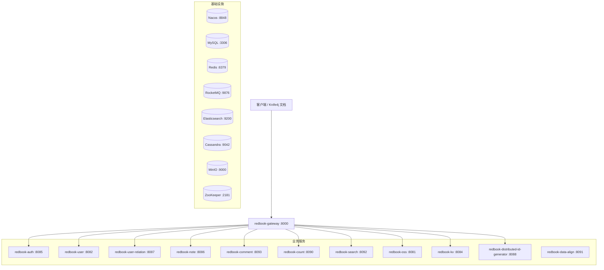

# Redbook · 微服务版小红书

基于 Spring Cloud Alibaba 的微服务架构学习项目，覆盖认证登录、用户资料、关注关系、笔记、评论、计数、搜索、对象存储、分布式 ID 等核心能力。

> 本项目仅用于技术学习与交流，与「小红书」官方无任何关联，不包含任何官方素材。

## 技术栈

| 分类 | 技术 |
| --- | --- |
| 基础框架 | JDK 17、Spring Boot 3.0.2、Spring Cloud 2022.0.0、Spring Cloud Alibaba 2022.0.0.0 |
| 服务治理 | Nacos（注册/配置）、Spring Cloud Gateway、OpenFeign、Sentinel |
| 认证授权 | Sa-Token 1.38.0 |
| 数据访问 | MyBatis、Druid、MySQL 8、Spring Data Cassandra |
| 中间件 | Redis、RocketMQ、Elasticsearch 7.3、Cassandra |
| 对象存储 | MinIO |
| 分布式 ID | 美团 Leaf（号段 + Snowflake） |
| 接口文档 | Knife4j / SpringDoc |
| 工具库 | Lombok、Hutool、Guava、Caffeine、TransmittableThreadLocal |

## 系统架构



## 模块说明

| 模块 | 端口 | 说明 |
| --- | ---: | --- |
| `redbook-gateway` | 8000 | 统一入口、路由转发、Knife4j 文档聚合 |
| `redbook-auth` | 8085 | 登录注册、短信验证码、Sa-Token 会话 |
| `redbook-user` | 8082 | 用户资料 |
| `redbook-user-relation` | 8087 | 关注 / 粉丝关系 |
| `redbook-note` | 8086 | 笔记发布与管理 |
| `redbook-comment` | 8093 | 评论 |
| `redbook-count` | 8090 | 用户 / 笔记计数（Redis + Lua） |
| `redbook-kv` | 8084 | 基于 Cassandra 的笔记/评论正文 KV 存储 |
| `redbook-oss` | 8081 | 基于 MinIO 的文件上传 |
| `redbook-search` | 8092 | 基于 Elasticsearch 的搜索 |
| `redbook-data-align` | 8091 | 数据对齐服务（骨架，待完善） |
| `redbook-distributed-id-generator` | 8088 | 基于 Leaf 的分布式 ID 生成 |
| `redbook-framework` | - | 公共组件：common、jackson、biz-context、operationlog |

## 环境依赖

| 组件 | 版本/端口 | 说明 |
| --- | --- | --- |
| JDK | 17+ | 编译与运行 |
| Maven | 3.8+ | 构建 |
| MySQL | 3306 | 业务库 `redbook`、Leaf 号段库 `leaf` |
| Redis | 6379 | 缓存、会话、计数 |
| Nacos | 8848 | 注册中心，命名空间 `redbook`，分组 `DEFAULT_GROUP` |
| RocketMQ | 9876 | 异步消息 |
| Elasticsearch | 9200 | 搜索 |
| Cassandra | 9042 | keyspace `redbook` |
| MinIO | 9000 | 对象存储 |
| ZooKeeper | 2181 | Leaf Snowflake |

## 快速开始

### 1. 初始化数据库

在 MySQL 中创建 `redbook` 与 `leaf` 两个库，并导入表结构。

> 当前仓库暂未附带 SQL 初始化脚本，可根据 `src/main/resources/mapper` 与实体类自行建表，后续计划补充。

### 2. 启动中间件

按需启动 MySQL、Redis、Nacos、RocketMQ、Elasticsearch、Cassandra、MinIO、ZooKeeper，默认地址均为 `127.0.0.1`。

### 3. 配置环境变量

所有敏感配置均已改为通过环境变量注入，未设置时使用本地开发默认值：

| 环境变量 | 说明 | 默认值 |
| --- | --- | --- |
| `ALIYUN_ACCESS_KEY_ID` | 阿里云短信 AccessKeyId | 空（不配置则短信登录不可用） |
| `ALIYUN_ACCESS_KEY_SECRET` | 阿里云短信 AccessKeySecret | 空 |
| `DB_PASSWORD` | MySQL 密码 | `132982` |
| `DRUID_PASSWORD` | Druid 监控台密码 | `admin` |
| `MINIO_ACCESS_KEY` | MinIO AccessKey | `linear` |
| `MINIO_SECRET_KEY` | MinIO SecretKey | `13298278` |

PowerShell 示例：

```powershell
$env:DB_PASSWORD = "your_password"
$env:ALIYUN_ACCESS_KEY_ID = "your_access_key_id"
$env:ALIYUN_ACCESS_KEY_SECRET = "your_access_key_secret"
```

### 4. 构建并启动

```bash
mvn clean install -DskipTests
```

先启动中间件，再启动业务服务，最后启动网关。以 IDEA 直接运行各模块的 `*Application` 启动类即可，或使用：

```bash
mvn -pl redbook-gateway spring-boot:run
```

### 5. 访问接口文档

启动网关后访问 Knife4j 聚合文档：

```text
http://localhost:8000/doc.html
```

## 目录结构

```text
redbook
├── redbook-framework/                  # 公共组件
├── redbook-gateway/                    # 网关
├── redbook-auth/                       # 认证服务
├── redbook-user/                       # 用户服务
├── redbook-user-relation/              # 用户关系服务
├── redbook-note/                       # 笔记服务
├── redbook-comment/                    # 评论服务
├── redbook-count/                      # 计数服务
├── redbook-kv/                         # KV 存储服务
├── redbook-oss/                        # 对象存储服务
├── redbook-search/                     # 搜索服务
├── redbook-data-align/                 # 数据对齐服务
├── redbook--distributed-id-generator/  # 分布式 ID 服务
└── pom.xml                             # 父 POM
```

## 配置说明

- 各服务配置位于 `src/main/resources/config/`，网关配置位于 `src/main/resources/`。
- 默认激活 `dev` 环境（`application-dev.yml`）。
- 本地开发中间件默认地址均为 `127.0.0.1`，部署时请通过配置中心或环境变量覆盖。
- `redbook-distributed-id-generator` 的号段配置位于 `leaf.properties`，仍保留本地默认值，部署前请修改。

## 免责声明

本项目为个人学习 Spring Cloud Alibaba 微服务架构的实践项目，与「小红书」官方无任何关联，不包含任何官方素材。项目中涉及的名称仅用于技术示例，请勿用于商业用途。

## License

[MIT](LICENSE)
